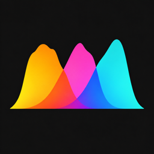
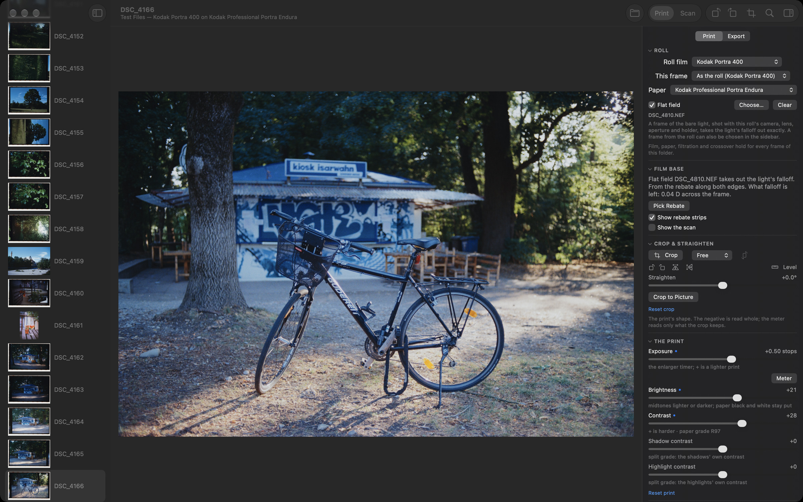
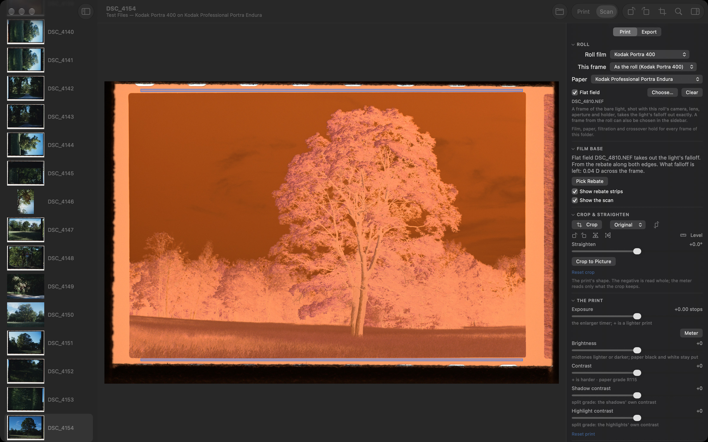
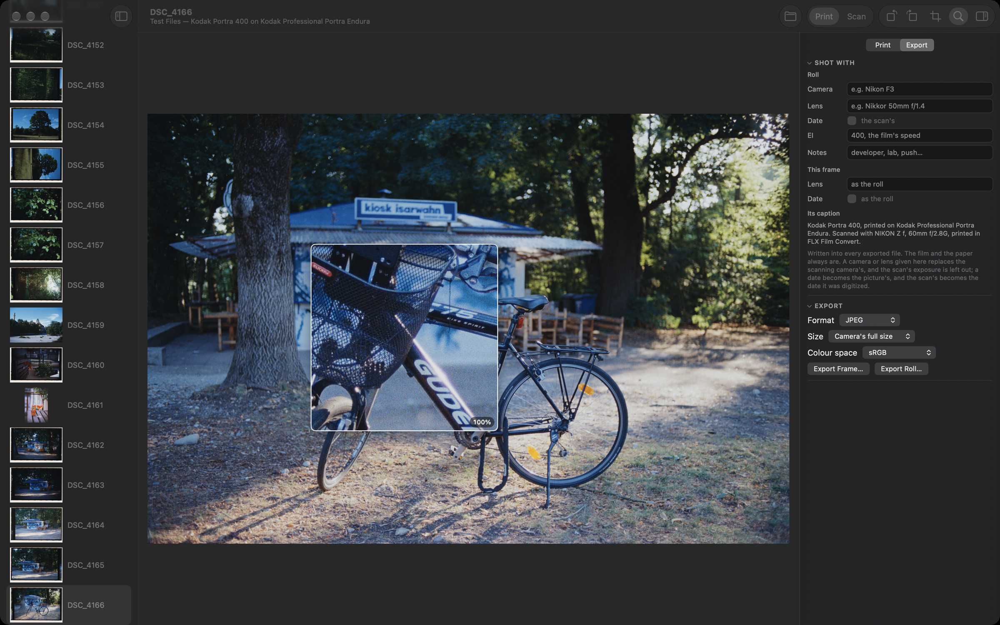

<p></p>

# FLX Film Convert

FLX Film Convert turns camera scans of film negatives into prints. It is a companion to
[FLX Film Lab](https://github.com/felixjablonka/flx-film-lab), and it prints with FLX Film Lab's own
engine and film data: each negative goes through its stock's dyes, an enlarger and a real
photographic paper, as it would in a darkroom.

> **Experimental.** FLX Film Convert is younger than FLX Film Lab and still rough around the edges.
> Things are missing, settings may change from one version to the next, and so far it has been used
> with few scanning setups (Nikon Z 7 and Z f scans of 35 mm and 120 film). Keep your raw files.



## What it does

- **No guessing from the picture.** Other converters balance each frame from what it shows, so its
  colours swing with the scene. Here the colours come from the film: the rebate (the unexposed film
  base along the edges) is the only reference, and each negative is read through its stock's own dye
  spectra. Nothing is set from the image.
- **A darkroom print.** The negative is printed on one of FLX Film Lab's papers with its print
  controls: exposure, brightness, contrast and split contrast, shadows and highlights, colour balance
  on the enlarger's filters, regional colour, pre-flash, dodge and burn with graduated, oval and
  polygon masks, and Bloom & Glow.
- **A roll at a time.** Film, paper and colour balance are set once for the roll, and a frame can
  have its own. The sidebar shows every frame as a print.
- **Crop to Picture** levels and crops each frame to the picture's edges, found from the film's
  rebate and the gaps between frames.
- **Flat field:** a frame of the bare scanning light takes out its falloff, where the rebate alone
  only estimates it.
- **Detail:** sharpness and local contrast (CLAHE) on the print's lightness, so they change no
  colour, and a loupe that shows the print at 100%.
- **Metadata:** every export names its film and paper, and the Export tab adds the camera, lens,
  date and film speed the pictures were taken with.

The film menus list the negatives still sold new: Kodak's Ektar, Gold, Ultramax, Portra, Tri-X,
T-Max, Vision3 and Verita stocks and Ilford HP5 Plus.





`docs/how-it-works.md` explains each step.

## Requirements

- A Mac with Apple silicon and macOS 26 or later.
- Raw camera scans (any raw format Core Image reads) of colour or black-and-white negatives, lit by
  a broadband white light. Narrowband RGB lights are not modelled.
- Scans that show the film's rebate along both long edges.

## Download

Each release comes as a disk image, on the
[Releases](https://github.com/felixjablonka/flx-film-convert/releases) page: open it and drag FLX
Film Convert to Applications. The app is not signed with a paid Apple developer certificate, so
macOS refuses the first launch, calling it damaged or from an unidentified developer. Run this once
in Terminal, then open it normally:

```bash
xattr -cr "/Applications/FLX Film Convert.app"
```

That removes the "downloaded from the internet" flag; it does not change the app. A build made on
your own Mac (below) needs none of this.

## Building

With the Command Line Tools for Xcode installed (`xcode-select --install`), in this folder:

```bash
./build.sh
```

That makes `FLX Film Convert.app` here, and `build/flxconvert`, the command-line tool;
`./build.sh dmg` also packages `build/FLX Film Convert.dmg`. Quit the app before building it again: a
bundle replaced under a running app breaks its Open and Save panels, so `build.sh` refuses.

`engine/` holds a snapshot of FLX Film Lab's engine, from the release `engine/VERSION` names (1.3.0).
To build on a newer FLX Film Lab, run `./sync-engine.sh PATH`, with PATH a checkout of it.

## Scanning

- Show both long edges of the film: the rebate along them is the reference. Sprocket holes may be in
  the frame; they are left out. When only one edge shows, it stands in for both.
- Expose so the rebate is just below clipping.
- The light's colour temperature hardly matters: the rebate cancels it, and a print changes little
  for any light from 2800 to 6500 K.
- A frame of the bare light, shot with the same camera, lens, aperture and holder as the roll, can
  serve as the roll's flat field.

## Using it

1. **Open Roll** (⌘O) and choose a folder of raw scans.
2. In the **Roll** section, choose the film and the paper. Each frame prints with the film's own
   print time; set the exposure, contrast and colour balance from there.
3. **Crop to Picture** in Crop & Straighten levels and crops a frame.
4. The **Export** tab holds what the pictures were shot with, and **Export Frame** (⌘E) or
   **Export Roll** (⇧⌘E) writes JPEG or 16-bit TIFF files.

A double-click on a slider puts it back, each section has a reset link, and **Frame > Reset Frame**
(⌥⌘R) starts a frame over. There is no undo yet.

## Command line

```bash
build/flxconvert scan.NEF print.jpg --film kodak_portra_400
```

Options: `--paper STOCK`, `--exposure STOPS`, `--grade R`, `--filter-y CC`, `--filter-m CC`,
`--pick x0,x1,y0,y1` (a rebate picked by hand, in frame fractions), `--turns N`, `--size PX`,
`--sharpness K`, `--radius PX`, `--masking 0-1`, `--clahe 0-1`, and for the metadata `--camera`,
`--lens`, `--date YYYY-MM-DD`, `--ei N` and `--notes`. `flxconvert --read-metadata FILE` shows what a
file says about itself.

## Licence

The code is GPLv3 (`LICENSE`): FLX Film Convert is built on FLX Film Lab, which is GPLv3 as
spektrafilm, the film model it ports, is. The film and paper data in
`engine/FLXFilmLab/Resources/packs/` is CC BY-SA 4.0, as spektrafilm's profiles are. The app icon is
© Felix Jablonka, all rights reserved: neither licence covers it, so a fork needs its own.
`NOTICE.md` lists everything this builds on.

Film, paper, camera and format names (Kodak, Fujifilm, Ilford, Nikon and their products) are
trademarks of their owners, used here only to say what a profile models or what a scan was made
with. FLX Film Convert is not affiliated with or endorsed by any of them.
